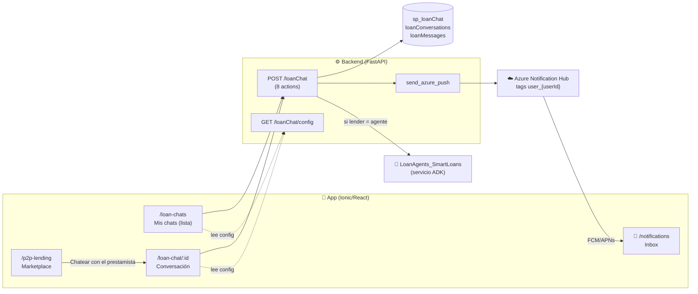
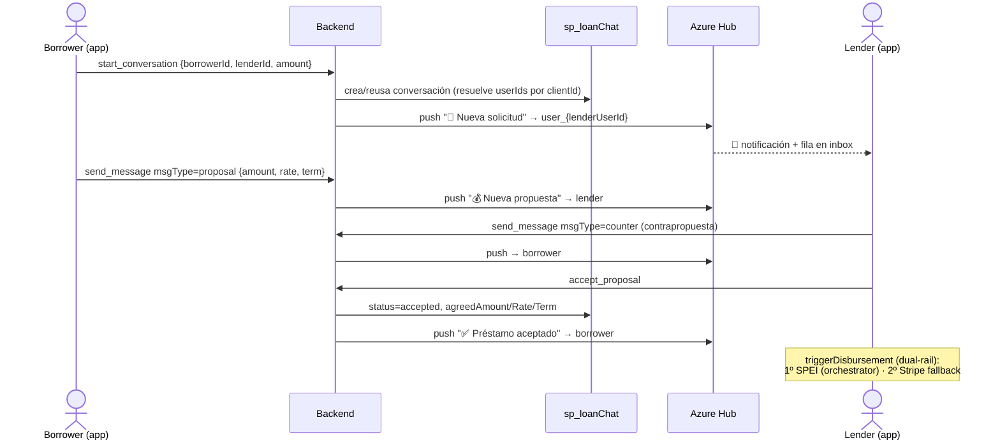
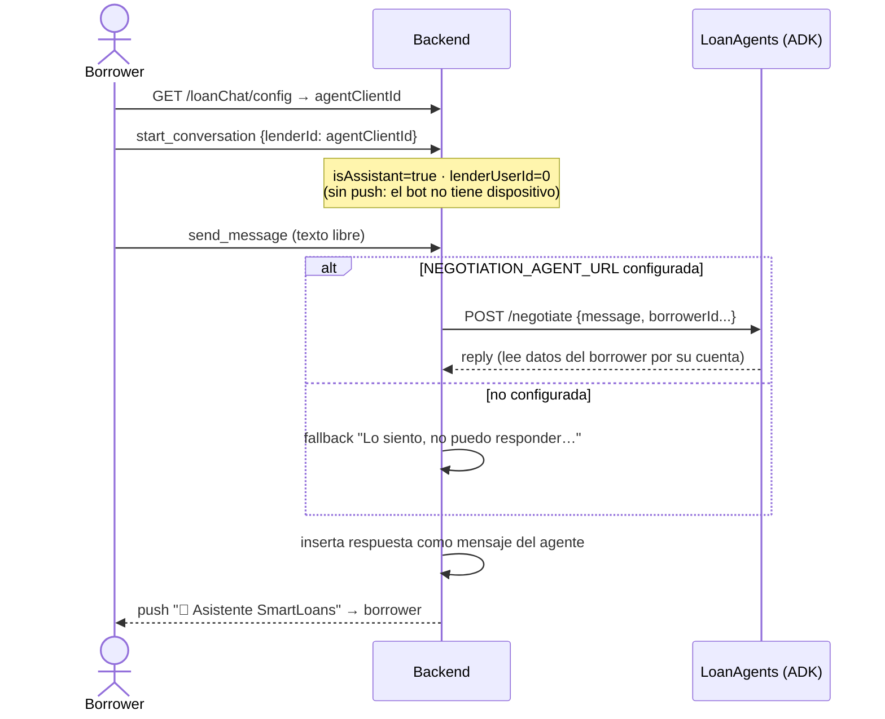

# Chat de Préstamo — Diseño y Casos de Uso

> Última actualización: 2026-07-30
> Frontend: `src/pages/loans/LoanChatPage.tsx`, `LoanChatListPage.tsx`, `src/api/loanChatApi.ts`
> Backend: `modules/loanChat.py`, `routes_/loanChat.py`, `sql/sp_loanChat.sql`
> Agente IA: servicio independiente [LoanAgents_SmartLoans](https://github.com/montanogilberto/LoanAgents_SmartLoans) (ADK, vía HTTP)

## 1. Componentes



## 2. Identidad del asistente — una sola fuente de verdad

El "Asistente SmartLoans" es una fila reservada de `dbo.clients` (tipo lender) **sin** fila en `users` (sin dispositivo, sin push). Su identidad vive **únicamente** en el backend:

| Variable de entorno | Efecto |
|---|---|
| `LOANCHAT_AGENT_CLIENT_ID` | Activa el asistente. Sin ella: botón oculto en la app y sin auto-respuesta. |
| `NEGOTIATION_AGENT_URL` | URL del servicio ADK. Sin ella (pero con la anterior): el bot responde el mensaje fallback. |

**El frontend nunca hardcodea el clientId.** Lo lee de `GET /loanChat/config`:

```json
{ "agentClientId": 2127, "agentEnabled": true, "agentReplyEnabled": false }
```

Además, el backend etiqueta cada conversación con `isAssistant: true/false` en
`start_conversation` / `get_conversation` / `list_conversations`, así la UI decide
el modo sin comparar ids.

## 3. Casos de uso

### UC-1 · Negociación real (borrower ↔ lender) — camino feliz

La única forma de iniciar una negociación es **desde una oferta** del marketplace
(así ambas partes siempre existen).



Al aceptar, el frontend ejecuta el desembolso **dual-rail**: SPEI primero
(`disbursePayment`, idempotencyKey `chat:{convId}:disburse:{ts}`), Stripe como
segunda opción. Se crea el préstamo con cuotas.

### UC-2 · Rechazo

`reject_proposal` → status `rejected` + push "❌ Propuesta rechazada" a la contraparte. La conversación queda cerrada para propuestas.

### UC-3 · Chat con el asistente (borrower ↔ bot)



**Reglas del modo asistente (UI):**
- Título "🤖 Asistente SmartLoans" + banner informativo.
- **Sin botón de propuesta** — el bot no puede aceptar dinero; solo texto.
- Botón de entrada visible solo para borrowers y solo si `agentEnabled`.

### UC-4 · Lista "Mis chats" (`/loan-chats`)

Entrada del menú para ambos roles. Muestra contraparte, estado, monto y última
actividad; tap abre la conversación. Empty-state → marketplace.

### UC-5 · Guard anti-conversación basura

`/loan-chat/new` **sin** ambas partes (o partes iguales) → toast + redirect a
`/loan-chats`. Esto eliminó las conversaciones `lenderId=0` cuyos pushes iban a
`userId 0` (nadie).

### UC-6 · Push y rastreo

1. El dispositivo se registra en el Hub con tag `user_{userId}` (⚠️ userId ≠ clientId).
2. El backend **mapea clientId→userId** antes de enviar (fix: tags vacíos devolvían "success" silencioso).
3. Cada envío inserta en `PushNotifications` + `NotificationDeliveries` (por usuario).
4. La campana 🔔 lee `POST /myNotifications` (badge = no leídas) y marca leídas al abrir.

| Evento | Push a | Título |
|---|---|---|
| start_conversation | lender | 📨 Nueva solicitud de préstamo |
| proposal / counter | contraparte | 💰 Nueva propuesta de préstamo |
| texto | contraparte | 💬 Nuevo mensaje |
| accept_proposal | contraparte | ✅ Préstamo aceptado |
| reject_proposal | contraparte | ❌ Propuesta rechazada |
| respuesta del bot | borrower | 🤖 Asistente SmartLoans |
| cualquier evento → bot | nadie (targetUserId=0 se omite) | — |

## 4. Matriz de configuración

| `LOANCHAT_AGENT_CLIENT_ID` | `NEGOTIATION_AGENT_URL` | Comportamiento |
|---|---|---|
| ✗ | — | Sin asistente: botón oculto, sin auto-reply, sin tag `isAssistant`. |
| ✓ | ✗ | Asistente visible; responde el **fallback**. |
| ✓ | ✓ | Asistente con respuestas reales del agente ADK. |

> **Deploy:** ambas variables deben configurarse en Azure Portal →
> smartloansbackend → Configuration (ya están en el `.env` local).
