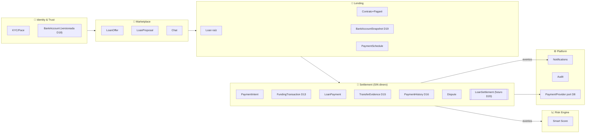
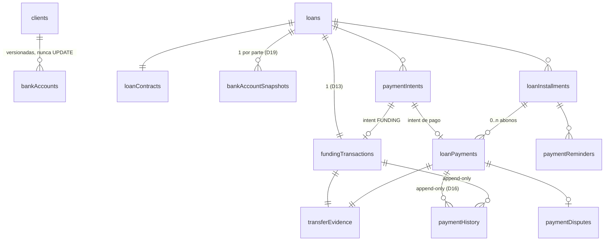
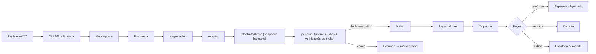
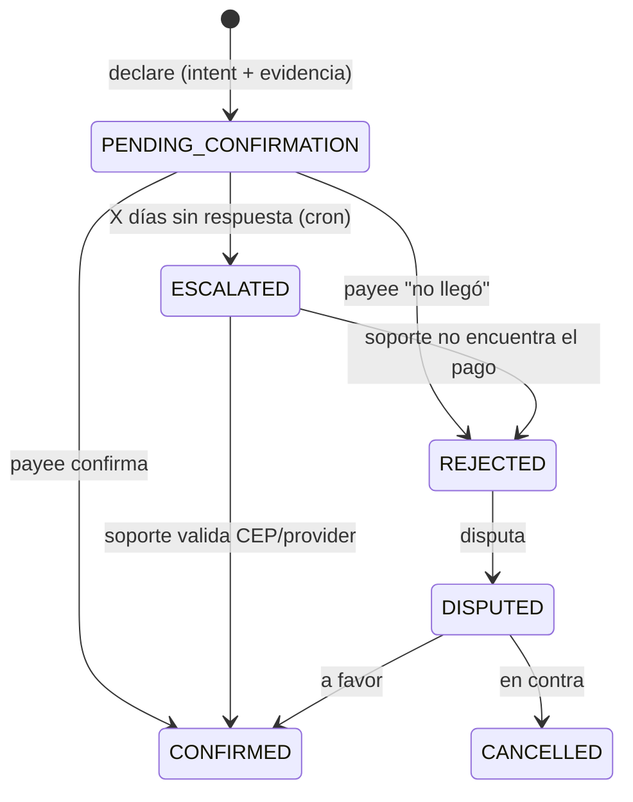

# SmartLoans — Arquitectura P2P de Pagos Directos (SPEI sin custodia)

> **Versión 1.3 · 2026-10-30 · ARQUITECTURA CONGELADA** — documento base del dominio.
> Cambios posteriores SOLO vía RFC (§16). Changelogs al final.
>
> Principio rector: **SmartLoans nunca recibe, guarda, transfiere ni custodia dinero.**
> El dinero viaja SIEMPRE por SPEI directo entre prestamista y prestatario.
> **Regla de oro operativa: el sistema JAMÁS confirma dinero automáticamente — confirma una persona o escala a soporte.**

---

## 0. Decisiones de arquitectura y su razón

| # | Decisión | Razón |
|---|---|---|
| D1 | **Sin custodia**: la billetera deja de ser depósito de valor | Evita el perímetro de captación (Ley Fintech/CNBV) |
| D2 | El ledger existente (`walletTransactions`) **cambia de rol** a libro de conciliación (asientos informativos) | Conserva trazabilidad sin reescribir; un asiento informativo no es un pasivo |
| D3 | **CLABE obligatoria al registro** (banco + CLABE + titular) | Sin riel no hay marketplace |
| D4 | CLABE **cifrada at-rest**, enmascarada (`clabeLast4`); revelada solo a la contraparte de un préstamo, auditada | Mínimo privilegio sobre dato bancario |
| D5 | **Confirmación humana siempre**: payee confirma; sin respuesta en X días → **ESCALATED** → soporte resuelve con CEP/provider. **No existe auto-confirmación** | Un comprobante falso + un lender ausente no pueden fabricar un pago confirmado |
| D6 | **Máquinas de estado** persistidas + transiciones solo vía SP con matriz de validez | La consistencia no depende del frontend |
| D7 | **Event-driven**: toda transición emite evento de dominio; push, recordatorios y **Risk Engine → Smart Score** son consumidores — nunca inline | Desacople: agregar consumidores no toca el flujo |
| D8 | **Payment Provider Abstraction**: el dominio solo conoce `PaymentProvider` (§15) | Migrar de proveedor = un adapter, cero dominio |
| D9 | Convenciones POS GMO: `companyId`, SPs `@pjsonfile`, camelCase, **posgmo-factory** | Coherencia con el pipeline |
| D10 | Comisión de conexión vía Stripe (tarjeta) al generar contrato — fuera del flujo del préstamo | Monetiza el servicio sin tocar el dinero prestado |
| D11 | **Cadena de verificación de CLABE**: mod-10 → banco ABM → **no duplicada** → micro-depósito (futuro vía provider) | Evoluciona por eslabones sin rediseño |
| D12 | **Fondeo con expiración (5 días)** → `expired` → regreso al marketplace | Sin préstamos congelados |
| D13 | **`FundingTransaction` y `LoanPayment` separados — también en SQL** (tablas distintas) | El fondeo *crea* un préstamo; el pago lo *amortiza*. Ciclos de vida, reglas y consecuencias distintas — mezclarlos acopla dominios |
| D14 | **`PaymentIntent`**: toda declaración nace de una intención registrada (monto esperado, beneficiario, referencia) | Patrón Stripe; enchufe natural para STP/CoDi sin tocar dominio |
| D15 | **`TransferEvidence` = datos estructurados + hash** (rastreo, bancos, fecha/hora, monto, CEP validado); el archivo es adjunto opcional. Jerarquía: clave de rastreo → CEP Banxico → screenshot | Los datos se verifican y consultan; el PDF se regenera; el screenshot se falsifica. El nombre es *Transfer*: mañana cubre CoDi/Open Finance/ACH/Wire |
| D16 | **`paymentHistory` append-only**: NUNCA se modifica un `status` sin insertar (oldStatus, newStatus, userId, fecha, razón, ip, device). Solo INSERT | Oro de auditoría: la historia no se edita, se acumula |
| D17 | **Beneficiary Verification**: se guarda el titular esperado y la app exige verificarlo antes del SPEI (“si el banco muestra otro nombre, NO transfiera”) | Mata el fraude de cuenta sustituida en el momento exacto donde ocurre |
| D18 | **CLABE inmutable**: jamás `UPDATE`. Nueva CLABE → `PENDING_VERIFICATION` → primaria solo sin préstamos activos → anterior `ARCHIVED` | El historial bancario es versionado, no editado |
| D19 | **`bankAccountSnapshot` al nacer el préstamo**: el préstamo recuerda banco+CLABE del momento del contrato, no el perfil actual | El lender puede cambiar de banco; el contrato decía BBVA/CLABE X — coherencia histórica y probatoria |
| D20 | **`LoanSettlement` (agregado futuro, documentado)**: encapsulará pagos, liquidaciones, descuentos, quitas, pagos extraordinarios, cierre, collections y recoveries | No se necesita hoy; se reserva el lugar en el dominio para que el ciclo completo (Funding→Payments→Disputes→ChargeOff→Collections→Recoveries→Settlement) tenga dueño cuando haya miles de préstamos |

---

## 1. Modelo de dominio (DDD)



**Agregados:**
- **`Loan`** (raíz): contrato, calendario, snapshot bancario, estado. Invariantes: no `ACTIVE` sin contrato firmado y funding confirmado; no `PAID_OFF` con cuotas sin confirmar.
- **`FundingTransaction`** (raíz propia, D13): el desembolso. Crea el préstamo activo. Tabla propia.
- **`LoanPayment`** (raíz propia): cuota/abono/liquidación. Amortiza. `paymentType ∈ {INSTALLMENT, PARTIAL, PAYOFF}` — **FUNDING ya no es un paymentType**.
- **`PaymentIntent`** (D14): expectativa de transferencia (aplica a funding y a pagos).
- **`TransferEvidence`** (D15): datos estructurados del SPEI + hash; adjunto opcional.
- **`Dispute`**: desde pago `REJECTED` o escalado resuelto en contra.
- **`LoanSettlement`** (D20, futuro): dueño del cierre económico del préstamo.

**Eventos de dominio**: `FundingDeclared/Confirmed/Expired`, `PaymentDeclared/Confirmed/Rejected/Escalated`, `DisputeOpened/Resolved`, `LoanActivated/PaidOff/Defaulted`. Consumidores: Notifications, Reminders, Risk Engine, Audit.

---

## 2. Diagrama ER



---

## 3. Tablas SQL

> Vía **posgmo-factory** (PRDs §16). DDL objetivo:

```sql
-- ── bankAccounts: versionadas (D18) — ALTER, no recrear ──
ALTER TABLE dbo.bankAccounts ADD
    clabeEncrypted VARBINARY(256) NULL,
    clabeHash      NVARCHAR(64)  NULL,     -- SHA-256 para unicidad sin exponer
    rfc            NVARCHAR(13)  NULL,
    accountStatus  NVARCHAR(22) NOT NULL DEFAULT 'PRIMARY';
        -- PRIMARY | PENDING_VERIFICATION | ARCHIVED
-- Regla D18 (en SP): nueva CLABE = INSERT en PENDING_VERIFICATION;
-- promover a PRIMARY solo si el cliente no tiene préstamos activos;
-- la anterior pasa a ARCHIVED. Jamás UPDATE de la CLABE misma.
CREATE UNIQUE INDEX UQ_bankAccounts_clabeHash
    ON dbo.bankAccounts (companyId, clabeHash) WHERE accountStatus <> 'ARCHIVED';

-- ── bankAccountSnapshots (D19) ──
CREATE TABLE dbo.bankAccountSnapshots (
    snapshotId    INT IDENTITY PRIMARY KEY,
    companyId     INT NOT NULL,
    loanId        INT NOT NULL,
    clientId      INT NOT NULL,             -- de quién es la cuenta
    partyRole     NVARCHAR(10) NOT NULL,    -- borrower | lender
    bankCode      NVARCHAR(5)  NOT NULL,
    bankName      NVARCHAR(60) NOT NULL,
    clabeEncrypted VARBINARY(256) NOT NULL, -- copia congelada al firmar
    clabeLast4    NVARCHAR(4)  NOT NULL,
    holderName    NVARCHAR(120) NOT NULL,   -- titular esperado (D17)
    created_At    DATETIME2 NOT NULL DEFAULT GETUTCDATE(),
    CONSTRAINT UQ_snapshot UNIQUE (loanId, partyRole)
);

-- ── paymentIntents (D14) ──
CREATE TABLE dbo.paymentIntents (
    intentId          INT IDENTITY PRIMARY KEY,
    companyId         INT NOT NULL,
    loanId            INT NOT NULL,
    installmentId     INT NULL,
    intentType        NVARCHAR(12) NOT NULL,   -- FUNDING|INSTALLMENT|PARTIAL|PAYOFF
    expectedAmountMXN DECIMAL(18,2) NOT NULL,
    payerClientId     INT NOT NULL,
    payeeClientId     INT NOT NULL,
    beneficiarySnapshotId INT NOT NULL,        -- snapshot del beneficiario (D17/D19)
    suggestedReference NVARCHAR(40) NOT NULL,  -- SL-{loanNumber}-{n}
    expiresAt         DATETIME2 NULL,          -- FUNDING: firma + 5d (D12)
    status            NVARCHAR(12) NOT NULL DEFAULT 'OPEN',  -- OPEN|DECLARED|EXPIRED|CANCELLED
    created_At        DATETIME2 NOT NULL DEFAULT GETUTCDATE()
);
CREATE INDEX IX_paymentIntents_expiry ON dbo.paymentIntents (status, expiresAt);

-- ── fundingTransactions (D13 — tabla PROPIA, no es un pago) ──
CREATE TABLE dbo.fundingTransactions (
    fundingId           INT IDENTITY PRIMARY KEY,
    companyId           INT NOT NULL,
    loanId              INT NOT NULL UNIQUE,   -- 1 fondeo por préstamo
    intentId            INT NOT NULL,
    lenderClientId      INT NOT NULL,
    borrowerClientId    INT NOT NULL,
    amountMXN           DECIMAL(18,2) NOT NULL,
    transferDate        DATE NOT NULL,
    status              NVARCHAR(25) NOT NULL DEFAULT 'PENDING_CONFIRMATION',
        -- PENDING_CONFIRMATION | CONFIRMED | REJECTED | ESCALATED | CANCELLED
    declaredAt          DATETIME2 NOT NULL DEFAULT GETUTCDATE(),
    confirmedAt         DATETIME2 NULL,
    confirmedByClientId INT NULL,
    escalatedAt         DATETIME2 NULL,
    created_At          DATETIME2 NOT NULL DEFAULT GETUTCDATE()
);

-- ── loanPayments (SOLO amortización: INSTALLMENT|PARTIAL|PAYOFF) ──
CREATE TABLE dbo.loanPayments (
    paymentId           INT IDENTITY PRIMARY KEY,
    companyId           INT NOT NULL,
    loanId              INT NOT NULL,
    intentId            INT NOT NULL,
    installmentId       INT NULL,
    paymentType         NVARCHAR(12) NOT NULL,  -- INSTALLMENT|PARTIAL|PAYOFF
    payerClientId       INT NOT NULL,
    payeeClientId       INT NOT NULL,
    amountMXN           DECIMAL(18,2) NOT NULL,
    paymentDate         DATE NOT NULL,
    status              NVARCHAR(25) NOT NULL DEFAULT 'PENDING_CONFIRMATION',
    declaredAt          DATETIME2 NOT NULL DEFAULT GETUTCDATE(),
    confirmedAt         DATETIME2 NULL,
    confirmedByClientId INT NULL,
    rejectedAt          DATETIME2 NULL,
    rejectReason        NVARCHAR(300) NULL,
    escalatedAt         DATETIME2 NULL,
    created_At          DATETIME2 NOT NULL DEFAULT GETUTCDATE(),
    CONSTRAINT CK_loanPayments_amount CHECK (amountMXN > 0),
    CONSTRAINT CK_loanPayments_type CHECK (paymentType IN ('INSTALLMENT','PARTIAL','PAYOFF'))
);
CREATE INDEX IX_loanPayments_loan    ON dbo.loanPayments (loanId, status);
CREATE INDEX IX_loanPayments_pending ON dbo.loanPayments (status, declaredAt);

-- ── transferEvidence (D15 — antes paymentEvidence) ──
CREATE TABLE dbo.transferEvidence (
    evidenceId        INT IDENTITY PRIMARY KEY,
    companyId         INT NOT NULL,
    subjectType       NVARCHAR(10) NOT NULL,   -- FUNDING | PAYMENT
    subjectId         INT NOT NULL,            -- fundingId o paymentId
    claveRastreo      NVARCHAR(30) NOT NULL,
    bancoOrigen       NVARCHAR(60) NULL,
    bancoDestino      NVARCHAR(60) NULL,
    fechaOperacion    DATE NOT NULL,
    horaOperacion     TIME NULL,
    montoMXN          DECIMAL(18,2) NOT NULL,
    cepValidado       BIT NOT NULL DEFAULT 0,
    validationProvider NVARCHAR(20) NOT NULL DEFAULT 'manual',
    evidenceHash      NVARCHAR(64) NOT NULL,   -- SHA-256(rastreo|bancos|fecha|monto)
    attachmentBlobUrl NVARCHAR(500) NULL,      -- opcional, blob privado
    uploadedByClientId INT NOT NULL,
    created_At        DATETIME2 NOT NULL DEFAULT GETUTCDATE(),
    CONSTRAINT UQ_transferEvidence_rastreo UNIQUE (companyId, claveRastreo)
);

-- ── paymentHistory (D16 — APPEND-ONLY, jamás UPDATE/DELETE) ──
CREATE TABLE dbo.paymentHistory (
    historyId    INT IDENTITY PRIMARY KEY,
    companyId    INT NOT NULL,
    subjectType  NVARCHAR(10) NOT NULL,        -- FUNDING | PAYMENT
    subjectId    INT NOT NULL,
    oldStatus    NVARCHAR(25) NULL,
    newStatus    NVARCHAR(25) NOT NULL,
    actorUserId  INT NULL,                     -- NULL = cron/sistema (solo escalados/expiraciones)
    reason       NVARCHAR(300) NULL,
    ipAddress    NVARCHAR(50) NULL,
    deviceInfo   NVARCHAR(200) NULL,
    created_At   DATETIME2 NOT NULL DEFAULT GETUTCDATE()
);
CREATE INDEX IX_paymentHistory_subject ON dbo.paymentHistory (subjectType, subjectId);
-- Regla D16 (en SPs): todo cambio de status en fundingTransactions/loanPayments
-- INSERTA aquí en la MISMA transacción. Sin excepción.

-- ── paymentDisputes / paymentReminders: igual que v1.1 ──

-- loans.loanStatus: draft | ready_for_disbursement | pending_funding | funded |
--                   active | in_dispute | paid_off | defaulted | expired | cancelled
```

---

## 4. Stored procedures

| SP | Acciones | Regla clave |
|---|---|---|
| `sp_paymentIntents` | `create` · `expire_due` · `cancel` · `list_for_loan` | FUNDING fija expiración +5d y captura `beneficiarySnapshotId` |
| `sp_fundingTransactions` | `declare` · `confirm` · `reject` · `escalate_due` · `resolve_escalation` | Separado de pagos (D13). `confirm` = borrower → loan `funded→active` + snapshot + calendario + recordatorios. Toda transición inserta `paymentHistory` |
| `sp_loanPayments` | `declare` · `confirm` · `reject` · `escalate_due` · `resolve_escalation` · `list_for_loan` | Solo amortización. Confirm → cuota paid + evento a Risk. Toda transición inserta `paymentHistory` en la misma transacción (D16) |
| `sp_transferEvidence` | `attach` · `validate_result` · `list` | Hash + monto vs intent; veredicto del provider |
| `sp_paymentDisputes` | `open` · `resolve` · `cancel` · `list` | Solo desde `REJECTED` |
| `sp_paymentReminders` | `schedule_for_loan` · `due_now` · `mark_sent` | T-3/T-1/DUE/OVERDUE |
| `sp_loanStatement` | (read) | Mínimo/total/vence/beneficiario (del **snapshot**, no del perfil) |
| `sp_bankAccounts` | + `add_pending` · `promote_primary` · `archive` · `reveal_counterparty` · `check_duplicate` | D18: INSERT-only; promoción bloqueada con préstamos activos; revelación auditada |
| `sp_loans` | + `transition` | Matriz §8; ilegal = error |

---

## 5. Endpoints FastAPI

```
POST /payments/intents             { loanId, installmentId?, intentType }
POST /funding/declare              { intentId, claveRastreo, bancoOrigen?, fecha, monto }
POST /funding/confirm              { fundingId }                     (borrower)
POST /funding/reject               { fundingId, reason }
POST /payments/declare             { intentId, claveRastreo, ... }
POST /payments/confirm             { paymentId }                     (payee)
POST /payments/reject              { paymentId, reason }
POST /evidence/attach              multipart opcional {subjectType, subjectId, file}
POST /escalations/resolve          { subjectType, subjectId, verdict, note }   (soporte)
POST /all_loanPayments             { loanId }         → pagos + funding + history
POST /loans/statement              { loanId, clientId }
POST /loans/disbursement-info      { loanId }         → snapshot beneficiario (lender; audit)
POST /disputes                     { action, ... }
POST /registration/bank-account    { clientId, clabe, bankCode, holderName }
POST /bank-accounts/replace        { clientId, clabe, ... }  → PENDING_VERIFICATION (D18)
Cron /jobs/intents/expire · /jobs/escalate · /jobs/reminders/dispatch
```

---

## 6. Pantallas frontend

**6.1 Registro — paso CLABE obligatorio** (mod-10 + banco + titular + no-duplicada; RFC opcional).

**6.2 Fondeo (lender)** — contador "5 días", datos del **snapshot** del borrower, y el aviso D17:

> ⚠️ **Antes de enviar, verifica que tu banco muestre:**
> **Titular: Juan Pérez**
> Si aparece otro nombre, **NO transfieras** y repórtalo.

"Ya transferí" → clave de rastreo + fecha + banco origen (+comprobante opcional).

**6.3 Pago del mes (borrower)** — estilo tarjeta (Nu/Plata): mínimo / liquidar / vence / beneficiario **del snapshot** + CLABE [Copiar] + **verificación de titular (D17)** → [Ya pagué] → evidencia estructurada.

**6.4 Confirmación (lender/payee)** + aviso "sin respuesta en X días pasa a soporte".
**6.5 Escalados (soporte)** y **6.6 Disputas**.
**6.7 Cambio de CLABE**: "Tu nueva cuenta queda en verificación; será primaria cuando no tengas préstamos activos. La anterior queda archivada" (D18).

**Se conservan**: LoanDetailPage (historial ahora incluye funding + payments + paymentHistory), dashboards, chat, inbox, asistente. **Se retira**: UI de billetera; Stripe solo para comisión.

---

## 7. Flujo de navegación



---

## 8. Máquinas de estado

**Préstamo:** `draft → ready_for_disbursement → pending_funding → funded → active → paid_off`, con `pending_funding → expired` (D12), `active ↔ in_dispute`, `active → defaulted`.

**FundingTransaction y LoanPayment (misma máquina, agregados distintos):**



Cada flecha = 1 INSERT en `paymentHistory` (D16) + 1 evento de dominio (D7).

---

## 9. Diagramas de secuencia

**Fondeo:** igual que v1.1 (§9) con dos adiciones: el disbursement-info sirve datos del **snapshot** y la pantalla exige la **verificación de titular** antes de transferir.

**Cuota:** igual que v1.1 — confirm → `PaymentConfirmed` (evento) → Risk Engine actualiza Smart Score de forma asíncrona; jamás inline.

---

## 10. Notificaciones push

Catálogo v1.1 + **"verifica el titular antes de transferir"** embebido en las pantallas de fondeo/pago (no push aparte), y **escalado→soporte** con cola propia.

## 11. Seguridad

v1.1 íntegra, más: (7) `paymentHistory` y `bankAccounts` son append-only — permisos SQL sin UPDATE/DELETE para el usuario de la app sobre esas tablas; (8) snapshots congelan el destino del dinero: un cambio de perfil bancario NUNCA altera préstamos en curso.

## 12. Validación · 13. Errores · 14. Auditoría

v1.1 íntegras, más: toda transición de status exige `reason` cuando es reject/escalate/resolve; `paymentHistory` captura ip/device del actor desde el middleware de observabilidad ya existente.

## 15. Payment Provider Abstraction

(Sin cambios desde v1.1 — el principio quedó validado en revisión.)

```python
class PaymentProvider(Protocol):
    def create_payment(self, intent) -> ProviderRef: ...
    def validate_payment(self, evidence) -> ValidationResult: ...
    def validate_cep(self, clave_rastreo, fecha, monto, clabe_dest) -> CepResult: ...
    def validate_clabe(self, clabe) -> ClabeResult: ...
    def get_payment_status(self, provider_ref) -> PaymentStatus: ...
```

`ManualProvider` (hoy) → `BanxicoCEPProvider` (fase 1.5, sin contrato) → `STPProvider` (validación/webhook, jamás custodia) → `CoDiProvider` / `OpenFinanceProvider`. Selección por configuración. El dominio nunca nombra a STP.

---

## 16. Gobernanza: arquitectura congelada + proceso RFC

**Este documento es la especificación base del dominio.** A partir de aquí, ninguna capacidad nueva se implementa "sobre la marcha": cada una entra por **RFC** (Request for Comments) que se discute contra este documento y, al aprobarse, lo enmienda con changelog.

**Formato RFC** (en `docs/rfcs/RFC-{nnn}-{slug}.md`): Contexto · Problema · Propuesta · Impacto en el dominio (agregados/eventos/estados) · Impacto en datos (tablas/SPs) · Seguridad · Plan de rollout · Alternativas descartadas.

**Backlog inicial:**

| RFC | Alcance | Mapea a |
|---|---|---|
| RFC-001 CLABE Verification | Cadena D11 completa + D17/D18 en registro | PRDs bankAccounts |
| RFC-002 Funding Workflow | Intent + expiración + snapshot + confirmación | PRDs paymentIntent, fundingTransaction |
| RFC-003 Payment Intents & Declarations | Pago del mes + evidencia + escalamiento | PRDs loanPayment, transferEvidence, paymentHistory |
| RFC-004 Smart Score Events | Risk Engine como consumidor de eventos | módulo riskEngine |
| RFC-005 STP Integration | `STPProvider` (validación only) | adapter |
| RFC-006 Collections Engine | Mora, planes, LoanSettlement (D20) | fase posterior |
| RFC-007 Legal Recovery | Pagaré → vía mercantil, expediente probatorio | fase posterior |
| RFC-008 Open Finance Integration | Confirmación bancaria automática | adapter |
| RFC-009 Laundry Prepaid Wallet | Monedero de la lavandería (companyId 1) fuera de `walletTransactions`; recarga en mostrador; uso de máquina = ticket del POS | PRD laundryWallet |

Los RFC-001 a 003 son el MVP del modelo sin custodia; sus PRDs van al posgmo-factory.

---

## Changelog

**v1.2 → v1.3 (RFC-009, 2026-10-30):**
1. **Monedero prepagado de la lavandería** (`docs/rfcs/RFC-009-laundry-prepaid-wallet.md`): el saldo que cobran las máquinas ESP32 es un pasivo de la lavandería con su cliente, en un libro propio append-only (`laundryWalletEntries`), no en `walletTransactions`. Reafirma D1/D2: `walletTransactions` sigue siendo informativo de SmartLoans y `LAUNDRY_USAGE` queda en desuso.
2. La recarga la registra una persona en el mostrador del POS (no hay auto-confirmación de dinero); cada uso de máquina es un ticket del POS con `paymentMethod = Monedero` (puntos y sellos en el uso, nunca en la recarga).

**v1.1 → v1.2 (2ª revisión de arquitectura):**
1. **`FundingTransaction` con tabla SQL propia** — FUNDING eliminado de `loanPayments.paymentType` (D13 ampliada).
2. **`paymentHistory` append-only** — ninguna transición sin INSERT (oldStatus/newStatus/actor/razón/ip/device) (D16).
3. **Beneficiary Verification** — titular esperado + advertencia obligatoria pre-SPEI (D17).
4. **CLABE inmutable/versionada** — PENDING_VERIFICATION → PRIMARY (sin préstamos activos) → ARCHIVED; jamás UPDATE (D18).
5. **`bankAccountSnapshot`** al nacer el préstamo — el contrato recuerda el banco de ese momento (D19).
6. **`paymentEvidence` → `transferEvidence`** — el concepto cubre SPEI/CoDi/Open Finance/ACH/Wire (D15).
7. **`LoanSettlement`** documentado como agregado futuro del ciclo completo (D20).
8. **Arquitectura CONGELADA + proceso RFC** (§16) con backlog RFC-001…008.

**v1.0 → v1.1 (1ª revisión):** eliminación de auto-confirm (→ESCALATED), CEP como evidencia principal, evidencia estructurada+hash, estados pending_funding/funded, expiración de fondeo 5d, cadena CLABE, Funding≠Payment en dominio, PaymentIntent, score por eventos, Payment Provider Abstraction completa.
