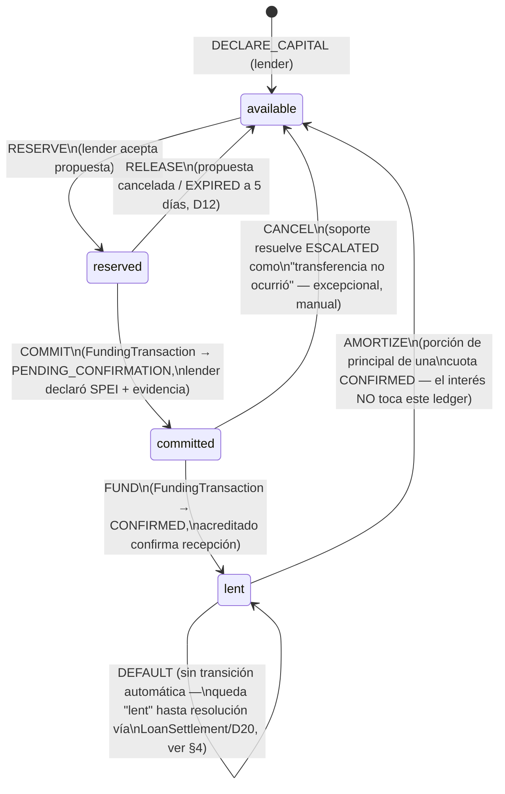
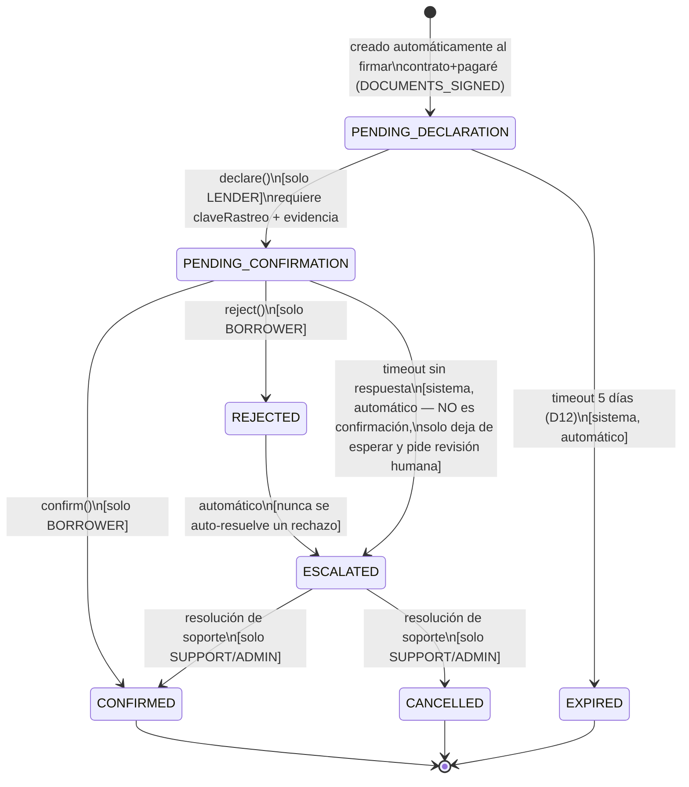
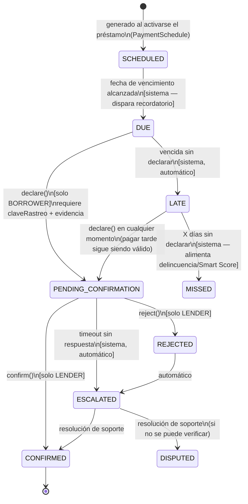

# SmartLoans — Semántica del Capital Ledger y Ciclo de Vida Funding/Payment

> **Estado: análisis/diseño de dominio, no código.** Este documento resuelve
> las dos ambigüedades señaladas antes de generar el PRD para posgmo-factory:
> (1) semántica y transiciones de `available/reserved/committed/lent`, y
> (2) ciclo exacto de `fundingTransactions` y `loanPayments` — qué evento
> mueve el estado del préstamo, qué es evidencia válida, y quién puede
> confirmar/rechazar. Nada de esto está frozen todavía — es la propuesta a
> validar antes de que se convierta en tablas/SPs reales (D6: máquinas de
> estado con matriz de validez).
>
> Referencias: [`p2p-direct-payments-architecture.md`](./p2p-direct-payments-architecture.md)
> (D5, D12, D13, D14, D15, D16, D20) ·
> [`payment-model-migration-matrix.md`](./payment-model-migration-matrix.md)

---

## 1. Capital Ledger — cuatro buckets, no tres

El primer borrador (matriz de migración) mencionaba `available / reserved /
committed / lent` sin definirlos. Hacía falta distinguir **reserved** de
**committed** porque representan riesgos distintos:

- **`reserved`** = el prestamista aceptó un préstamo, pero **todavía no ha
  movido dinero real**. Puede cancelarse sin consecuencias fuera de SmartLoans.
- **`committed`** = el prestamista **ya hizo el SPEI en el mundo real**
  (declaró la transferencia con evidencia). El dinero ya salió de su banco —
  la única pregunta pendiente es si el acreditado lo confirma. Esto ya NO es
  cancelable unilateralmente por el prestamista.

Colapsar estos dos en un solo bucket ocultaría exactamente el momento en que
el dinero deja de estar bajo control del prestamista — que es la información
más importante que el ledger virtual necesita capturar.

**Invariante:** `capitalDeclarado = available + reserved + committed + lent`
(por prestamista, en todo momento).

### 1.1 Definición de cada bucket

| Bucket | Significado | Dinero real ya se movió? |
|---|---|---|
| `available` | Capital declarado, libre para respaldar una nueva propuesta | No |
| `reserved` | Capital retenido por una propuesta aceptada, esperando que el prestamista declare el SPEI | No (soft-hold) |
| `committed` | El prestamista declaró el SPEI (con evidencia); esperando confirmación del acreditado | **Sí** |
| `lent` | Principal vigente de préstamos ya confirmados/activos | Sí (y ya reconocido como préstamo) |

### 1.2 Transiciones (evento → bucket origen → bucket destino)



### 1.3 Reglas explícitas

- **`available` solo puede reducirse por `RESERVE` o por el prestamista
  retirando capital declarado** (nunca por una operación de retiro de dinero
  real — no hay tal cosa, D1).
- **`reserved → committed` es el punto de no retorno** para el prestamista:
  antes de este paso, cancelar es gratis (no pasó nada en el mundo real);
  después, cancelar requiere intervención de soporte porque hay una
  transferencia bancaria real de por medio.
- **`committed → available` (CANCEL) es una operación excepcional**, solo
  ejecutable por soporte tras resolver un `ESCALATED`, y debe quedar
  registrada en `paymentHistory` (D16) con la razón — nunca es una
  transición automática del sistema.
- **El interés cobrado en una cuota nunca entra al capital ledger** — es
  ganancia del prestamista, no capital declarado. Si se quiere trackear,
  es un ledger de ganancias aparte, fuera de alcance de este documento.
- **`DEFAULT` no tiene transición automática de salida de `lent`** — un
  préstamo incumplido no libera capital "disponible" solo porque dejó de
  pagarse; eso requeriría una decisión de negocio (castigo contable,
  quita, cobranza) que D20 (`LoanSettlement`, agregado futuro) ya reserva
  como pendiente. Por ahora `lent` permanece congelado en ese préstamo hasta
  resolución manual.

---

## 2. Ciclo de vida de `FundingTransaction` (D13)

Cubre el fondeo inicial del préstamo (prestamista → acreditado).



### 2.1 Qué evento mueve el estado del `Loan`

| Evento en `FundingTransaction` | Efecto en `Loan.status` | Efecto en Capital Ledger |
|---|---|---|
| Creación (`PENDING_DECLARATION`) | `DOCUMENTS_SIGNED` → `FUNDING_PENDING` | `available → reserved` |
| `declare()` → `PENDING_CONFIRMATION` | sin cambio (sigue `FUNDING_PENDING`) | `reserved → committed` |
| `confirm()` → `CONFIRMED` | `FUNDING_PENDING` → `FUNDED` → `ACTIVE`¹ | `committed → lent` |
| `EXPIRED` (timeout) | `FUNDING_PENDING` → vuelve al marketplace (`EXPIRED`/`REQUESTED`) | `reserved → available` |
| `ESCALATED` | sin cambio de `Loan.status` (queda `FUNDING_PENDING`, visible como "en revisión") | sin cambio (sigue `committed`) |
| `CANCELLED` (soporte) | `FUNDING_PENDING` → `CANCELLED` (el contrato ya firmado debe anularse — flujo de anulación de contrato queda fuera de este documento) | `committed → available` |

¹ **Resuelto:** `FUNDED` y `ACTIVE` NO son el mismo instante.
`FUNDED` se marca en cuanto `confirm()` sucede (el dinero ya está
reconocido — el ledger ya pasa `committed → lent` aquí). `ACTIVE` requiere
un paso adicional: que el `PaymentSchedule` se haya generado exitosamente.
Si la generación del calendario falla, el préstamo queda en `FUNDED`
(fondeado, pero no operativo) en vez de en un estado ambiguo — evita que
`ACTIVE` mienta sobre tener cuotas programadas. Automatizar `FUNDED →
ACTIVE` no viola D5: D5 es sobre confirmar *dinero*, no sobre actualizar el
status bookkeeping una vez que el dinero ya fue confirmado por un humano.

### 2.2 Quién puede ejecutar cada transición

| Transición | Actor permitido |
|---|---|
| `declare()` | Solo el `lenderId` del `FundingTransaction` |
| `confirm()` / `reject()` | Solo el `borrowerId` del `FundingTransaction` (el payee, D5) |
| Resolver `ESCALATED` (`CONFIRMED`/`CANCELLED`) | Solo rol `support`/`admin` |
| `EXPIRED` | Sistema (job programado), nunca una persona |

---

## 3. Ciclo de vida de `LoanPayment` (cuotas, D13)

Mismo patrón que el fondeo, pero **invertido**: el acreditado es quien
declara, el prestamista es quien confirma (el prestamista es el payee).



### 3.1 Qué evento mueve el estado del `Loan` / `Installment`

| Evento | Efecto en `Installment.status` | Efecto en `Loan.status` | Efecto en Capital Ledger |
|---|---|---|---|
| `confirm()` → `CONFIRMED` | `PAID` | si es la última cuota → `COMPLETED` | `lent -= principal` (interés no toca el ledger), `lent → available` |
| `LATE` / `MISSED` (timeout) | `LATE`/`MISSED` | tras N cuotas vencidas → `DELINQUENT`/`DEFAULT` (umbral a definir como parámetro de negocio, no aquí) | sin cambio |
| `ESCALATED` → `DISPUTED` | `DISPUTED` | sin cambio | sin cambio hasta resolución |

### 3.2 Quién puede ejecutar cada transición

| Transición | Actor permitido |
|---|---|
| `declare()` | Solo el `borrowerId` del `LoanPayment` |
| `confirm()` / `reject()` | Solo el `lenderId` del `LoanPayment` |
| Resolver `ESCALATED` | Solo `support`/`admin` |
| `LATE` / `MISSED` / `DUE` | Sistema (jobs de fecha, no involucra dinero) |

---

## 4. Qué constituye evidencia válida (D15)

Jerarquía de confianza, de mayor a menor — pero **ninguna, ni la más
fuerte, sustituye la confirmación humana del payee** (D5 es absoluto):

1. **Clave de rastreo** (obligatoria siempre) — formato validado
   (alfanumérico, longitud según banco emisor), **única** por transacción
   (constraint `UNIQUE` — impide reusar la misma referencia en dos
   `fundingTransactions`/`loanPayments` distintos).
2. **CEP Banxico** (óptimo, opcional en v1) — si se provee, se valida contra
   la consulta pública de Banxico (candidato a automatización futura del
   *match* de monto/fecha, nunca de la confirmación misma).
3. **Screenshot** (fallback más débil, D15 lo señala explícito: "se
   falsifica") — nunca es suficiente por sí solo; siempre requiere que el
   payee confirme.

**Campos mínimos para `declare()` en cualquiera de los dos flujos:**

```
claveRastreo      (string, único, validado)
bankFrom / bankTo (código de banco)
amount            (debe coincidir con el monto esperado del PaymentIntent, D14 —
                   un mismatch no auto-rechaza, marca para revisión)
dateTime          (fecha/hora declarada de la transferencia)
concepto          (debe incluir la referencia SL-LOAN-XXX / SL-PAY-XXX)
evidenceFile      (opcional: CEP o screenshot)
```

Un mismatch de monto o referencia **no debe auto-rechazar** — pasa a
revisión (mismo patrón que timeout → `ESCALATED`), porque un error de
captura no es lo mismo que un fraude, y D5 exige que sea una persona quien
decida, no una regla automática.

---

## 5. Parámetros abiertos (no son decisiones de arquitectura, son config)

Estos números no están definidos en D1–D20 y no deberían inventarse en este
documento — quedan como parámetros a fijar con negocio antes del PRD:

- Días de espera antes de `PENDING_CONFIRMATION → ESCALATED` (tanto en
  funding como en pagos) — la memoria del proyecto ya registra que un
  auto-confirm a 72h fue removido explícitamente; el timeout a `ESCALATED`
  (que NO confirma dinero, solo pide revisión humana) puede tener un valor
  distinto y corto sin violar D5.
- Número de cuotas `LATE`/`MISSED` consecutivas que disparan
  `DELINQUENT`/`DEFAULT` en el `Loan`.
- Tolerancia de monto aceptable entre lo declarado y el `PaymentIntent`
  esperado antes de marcar mismatch para revisión (¿exacto? ¿± comisión
  bancaria?).

---

## 6. Resumen para el PRD

Con esto, las tablas mínimas que posgmo-factory necesita generar quedan
acotadas a:

- `capitalLedger` (o rename de `walletTransactions`) — columnas
  `available/reserved/committed/lent` por `lenderId`, con
  `paymentHistory`-style append-only si se quiere auditar cada transición
  del ledger también (recomendado, mismo patrón D16).
- `fundingTransactions` — máquina de estados de §2, FK a `Loan` y a
  `PaymentIntent` (D14).
- `loanPayments` — máquina de estados de §3, FK a `Installment` y a
  `PaymentIntent`.
- `transferEvidence` — estructura de §4, FK polimórfica a
  `fundingTransactions` o `loanPayments`.
- `paymentHistory` — un INSERT por cada transición de cualquiera de las dos
  máquinas de estado anteriores (D16, nunca UPDATE de status sin insertar
  aquí).
